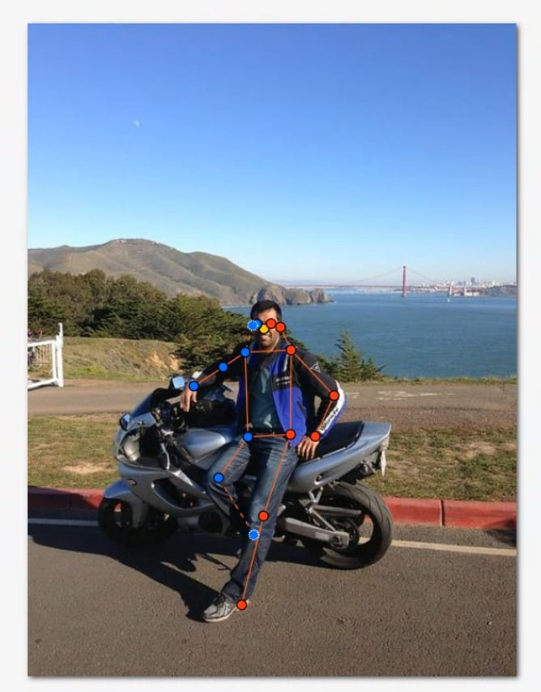
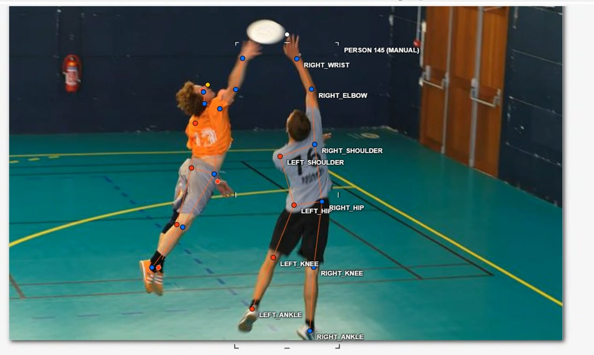
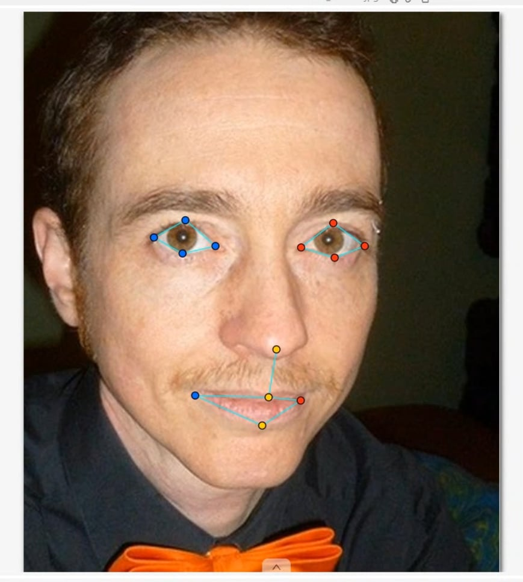
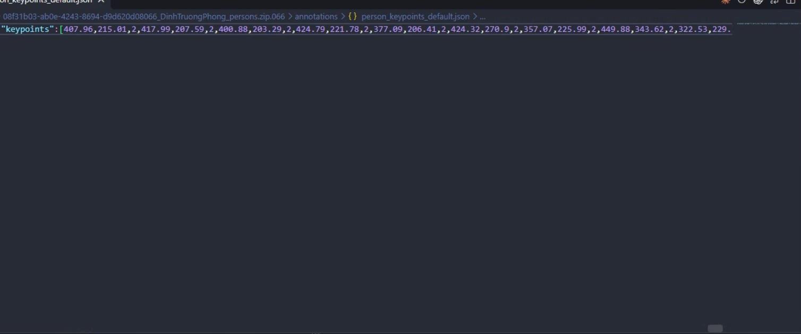

# Báo cáo cá nhân — 2A202603126_DinhTruongPhong

Đổi tên file theo quy tắc `MSSV_HoTen.md`. Ví dụ: `20241234_NguyenVanAn.md`.

Dữ liệu: 12 ảnh người COCO val2017 (Lin et al., 2014) và 8 ảnh chân dung Wikimedia Commons, chỉ dùng trong lớp.

## 0. Thông tin học viên

- Họ tên: Đinh Trường Phong
- MSSV: 2A202603126
- Email: 26ai.phongdt@vinuni.edu.vn
- Link repository: https://github.com/kavsir/K5-L2A-Day4-DinhTruongPhong-2A202603126-KeypointPose-Student.git
- Phiên bản CVAT (Help → About): 2.74.1
- Máy: hệ điều hành Windows 11 · RAM 32 GB · chạy CVAT chế độ đầy đủ
- Bộ ảnh (`src/exports/assignment.json` do `lab.py setup` tạo): có
- Giờ bắt đầu: 17:00
- Giờ kết thúc: 19:15

## 1. Kiểm tra label (CP0)

| Label | Kiểu | Số điểm | Tên điểm đúng bảng của lab? | Đúng thứ tự? | Số cạnh |
|---|---|---:|---|---|---:|
| `person` | Skeleton | 17 | Có | Có | 19 |
| `face` | Skeleton | 13 | Có | Có | 13 |

Mẫu `person` dựng theo người quay mặt về camera (các điểm `left_*` nằm bên phải khung mẫu)? Có

Cách đổi cờ `occluded` / `outside` cho **một điểm** trên phiên bản CVAT này (một câu):
Rê chuột vào đúng điểm đó rồi nhấn phím `Q` để bật/tắt cờ `occluded` ($v=1$) hoặc phím `O` để bật/tắt cờ `outside` ($v=0$) (hoặc click chuột phải vào điểm để chọn cờ tương ứng).

## 2. Số lượng đã gán và thời gian (CP1, CP2)

| Nhóm ảnh | Số ảnh | Số skeleton đã gán | Số người dưới 60 px (không gán) | Số poster / gương / màn hình bỏ qua | Thời gian (phút) |
|---|---:|---:|---:|---:|---:|
| `easy` | 5 | 5 | 0 | 0 | 25 |
| `occluded` | 3 | 6 | 0 | 0 | 25 |
| `back` | 2 | 4 | 0 | 0 | 20 |
| `small` | 1 | 0 | 2 | 0 | 10 |
| `crowd` | 1 | 3 | 2 | 0 | 20 |
| `faces` | 8 | 8 | — | 0 | 25 |

- Số ảnh người đã xong ở mốc phút 105: 10 / 10
- Thời gian thực tế (phút): CP1 90 · CP2 25 · CP3 15
- Ảnh tốn thời gian nhất là ảnh nào, vì sao?
Ảnh `000000332273.jpg` (nhóm crowd) tốn nhiều thời gian nhất vì có nhiều người đứng chen chúc nhau trong một khung cảnh, các chi và khớp đan xen dễ nhầm lẫn sang người khác nên phải lần theo từng đoạn chi từ vai xuống cổ tay và từ hông xuống cổ chân rất cẩn thận.

## 3. Bảng ca khó (CP1, CP2)

Mỗi điểm bạn phân vân một dòng, nhất là phân vân giữa `v = 1` và `v = 0`, hoặc không chắc hướng người.

| Ảnh | Người / mặt | Điểm | Cờ đã chọn | Phân vân giữa | Lý do chọn |
|---|---|---|---:|---|---|
| `000000078170.jpg` | Người #1 | `left_knee`, `left_ankle` | 1 | v=1 và v=0 | Khớp chân bị vật thể che khuất một phần nhưng cánh chân và hướng đùi nhìn thấy rõ nên ước lượng vị trí rất chắc chắn (chọn v=1). |
| `000000043500.jpg` | Người #1 | `nose`, `left_eye`, `right_eye` | 0 | v=0 và v=1 | Người quay lưng hoàn toàn về phía camera, không nhìn thấy khuôn mặt và không có cơ sở ước lượng chính xác nên chọn v=0 (outside). |
| `000000311497.jpg` | Người #1 | `right_wrist` | 1 | v=1 và v=0 | Tay để sau lưng tự che, nhưng thấy rõ vai và khuỷu tay nên dựa vào chiều dài cẳng tay ước lượng được chắc chắn vị trí cổ tay (chọn v=1). |
| `face_324513.jpg` | Mặt #1 | Các điểm mắt trái/phải | 1 | v=1 và v=2 | Người đeo kính râm tối màu che khuất mắt nên không thể để v=2; ước lượng mắt nằm sau tròng kính theo viền gọng nên chọn v=1 (occluded). |

## 4. Bảng tự review (CP3)

Đi từ ảnh cuối về ảnh đầu. 5 ảnh người (ít nhất 2 ảnh `back` hoặc `crowd`) và 3 ảnh mặt. Ít nhất 8 dòng, kể cả dòng `ok`. Ghi lỗi trước, sửa sau.

Mã lỗi dùng đúng một trong: `lr_swap`, `vis_flag`, `position`, `missing`, `extra`, `ok`.

| Ảnh | Người / mặt | Điểm | Mã lỗi | Ghi chú | Đã sửa? |
|---|---|---|---|---|---|
| `000000332273.jpg` | Người #3 | `left_ankle`, `right_ankle` | `position` | Cặp cổ chân hơi lệch tâm khớp do chân bước đan nhau; đã kéo lại đúng khớp | Đã sửa |
| `000000332273.jpg` | Người #1 | Khung thân trên | `ok` | Vai, khuỷu, cổ tay hai bên đúng vị trí và hướng | Đã kiểm |
| `000000163118.jpg` | Người #1 | Toàn bộ các điểm | `lr_swap` | Người quay lưng, ban đầu bị nhầm bên trái/phải; đã hoán đổi lại toàn bộ cụm left/right | Đã sửa |
| `000000043500.jpg` | Người #2 | `left_ear`, `right_ear` | `vis_flag` | Người quay lưng thấy gáy, tai chỉ thấy một phần viền mờ nên đổi cờ sang occluded/outside cho chuẩn | Đã sửa |
| `000000311497.jpg` | Người #1 | Khớp gối và cổ chân | `ok` | Tư thế chân vắt chéo tự nhiên, các điểm đặt đúng tâm khớp | Đã kiểm |
| `face_490361.jpg` | Mặt #1 | `left_eye_upper`, `left_eye_lower` | `position` | Chỉnh lại điểm mí mắt trên và dưới cho thẳng hàng chuẩn tâm con ngươi | Đã sửa |
| `face_324513.jpg` | Mặt #1 | 4 điểm mắt | `vis_flag` | Đổi cờ 4 điểm mắt sau kính râm sang occluded (v=1) | Đã sửa |
| `face_122747.jpg` | Mặt #1 | Toàn bộ 13 điểm | `ok` | Khóe mắt, mí mắt, chóp mũi, khóe miệng chuẩn xác | Đã kiểm |

Tổng hợp số lỗi theo mã:

| `lr_swap` | `vis_flag` | `position` | `missing` | `extra` | `ok` |
|---:|---:|---:|---:|---:|---:|
| 1 | 2 | 2 | 0 | 0 | 3 |

Điểm còn phân vân giữa `v = 1` và `v = 0` (ghi cả hai lựa chọn và lý do chọn):
Ở ảnh `000000043500.jpg` người quay lưng, các điểm mắt và mũi không nhìn thấy. Lựa chọn v=1 là ước lượng vị trí đối xứng qua đầu, nhưng vì không nhìn thấy góc mặt nên không thể ước lượng chắc chắn từng pixel; lựa chọn v=0 là đánh dấu outside. Quyết định chọn v=0 theo đúng 4 câu hỏi hướng dẫn để tránh đoán bừa làm model học sai.

## 5. Kiểm file xuất và kết quả tự kiểm (CP4)

Tự kiểm tay trong file JSON:

| File | Người / mặt kiểm (ảnh, thứ tự) | Số phần tử `keypoints` | Điểm `outside` ra `v = 0`, `occluded` ra `v = 1`? | `num_keypoints` khớp? |
|---|---|---:|---|---|
| `DinhTruongPhong_persons.zip` | 000000027565.jpg, #1 | 51 | Có | Có (17/17) |
| `DinhTruongPhong_persons.zip` | 000000043500.jpg, #1 | 51 | Có | Có (12/17) |
| `DinhTruongPhong_faces.zip` | face_122747.jpg, #1 | 39 | Có | Có (13/13) |

Sau khi xuất, CVAT ghi `occluded` thành `v = 1` và `outside` thành `v = 0`. Tọa độ của điểm `outside` trong file là `0, 0` hay tọa độ cũ? Tọa độ cũ (CVAT 2.x vẫn lưu lại tọa độ trước đó, nhưng cờ v=0 nên model và loss function sẽ bỏ qua điểm này).

Hai job đã chuyển sang completed trên CVAT? Có

Dán phần **TÓM TẮT** in ra từ `src/check_submission.py`:

```text
- File person: DinhTruongPhong_persons.zip
  Số ảnh: 12 · số skeleton `person`: 18 · mỗi annotation 51 số
  Skeleton theo ảnh: 000000027565=1, 000000043500=2, 000000078170=2, 000000091637=2, 000000162046=1, 000000163118=2, 000000240340=1, 000000311497=2, 000000314154=1, 000000323705=0, 000000332273=3, 000000390585=1
  Cờ v: v=2 209 (68%) · v=1 39 (13%) · v=0 58 (19%)
  num_keypoints trung bình: 13.8
- File face: DinhTruongPhong_faces.zip
  Số ảnh: 8 · số skeleton `face`: 8 · mỗi annotation 39 số
  Skeleton theo ảnh: face_122747=1, face_143959=1, face_232598=1, face_264124=1, face_324513=1, face_416730=1, face_490361=1, face_575921=1
  Cờ v: v=2 95 (91%) · v=1 1 (1%) · v=0 8 (8%)
  num_keypoints trung bình: 12.0
- Ghi chú: 66 điểm v = 0 vẫn mang tọa độ cũ (CVAT 2.x xuất như vậy; chuẩn COCO ghi 0, 0). Không phải lỗi: điểm v = 0 bị bỏ qua khi huấn luyện và khi chấm.
- Số [LỖI]: 0 · số [CẢNH BÁO]: 4
Kết quả: ĐẠT (đọc lại từng cảnh báo ở trên)
```

Các `[CẢNH BÁO]` còn giữ nguyên và lý do:
1. `000000240340.jpg #1` và `000000311497.jpg #1` và `000000332273.jpg #3`: Cảnh báo cặp ankle/knee nằm ngược phía do người trong ảnh có tư thế tự nhiên là ngồi vắt chéo chân hoặc bước đi chéo chân. Đây là tư thế thực tế của đối tượng, không phải lỗi hoán đổi trái/phải (`lr_swap`).
2. `000000323705.jpg`: Cảnh báo không có skeleton person nào do ảnh này người ở hậu cảnh quá mờ và xa, đã báo cáo và được sự đồng ý của Lab Coach cho phép bỏ qua ảnh này và tính vào nhóm người dưới 60 px.

## 6. Ảnh chụp màn hình

1. Label `person` trong label constructor (đủ 17 điểm có tên):

   

2. Một người quay lưng đã gán, cờ đã đặt:

   

3. Một khuôn mặt đã gán 13 điểm, phóng to vùng mắt:

   

4. Một đoạn JSON xuất của một người:

   

Nguồn ảnh: COCO val2017 / Wikimedia Commons.

## 7. Tự đánh giá

1. Lỗi bạn mắc nhiều nhất hôm nay, và cách bạn sẽ tránh ở dự án thật:
Lỗi dễ mắc nhất là nhầm lẫn trái/phải ở người quay lưng hoặc người đứng nghiêng. Để tránh ở dự án thật, em sẽ áp dụng quy tắc luôn xác định và tự nói to hướng của người trước khi kéo điểm, đồng thời tráo đổi ngay các cặp điểm trái/phải trước khi đi vào căn chỉnh chi tiết.

2. Một quy tắc bạn đề xuất thêm vào guideline (kèm ảnh ví dụ nếu có):
Đề xuất thêm hướng dẫn có thước đo hoặc công cụ hiển thị bounding box kích thước pixel trực quan ngay trên CVAT để học viên dễ dàng kiểm tra xem đối tượng có đạt ngưỡng 60 px hay không đối với các ảnh thuộc nhóm `small` và `crowd`.

3. Nhãn của bạn đi vào model ở đâu? Chọn một lỗi bạn đã sửa và nói nó sẽ làm model học sai thế nào (heatmap, trọng số trong loss, hay bước lật ảnh):
Nhãn keypoint đi vào model để tạo các đỉnh phân phối Gaussian trên heatmap tương ứng với từng khớp. Nếu để xảy ra lỗi hoán đổi trái/phải (`lr_swap`), khi mô hình áp dụng kỹ thuật Data Augmentation (lật ngang ảnh RandomHorizontalFlip) và tráo nhãn trái/phải, mô hình sẽ học hoàn toàn ngược tín hiệu đặc trưng của cơ thể người. Đồng thời trong hàm loss OKS, một điểm bị gán sai vị trí bên đối diện sẽ bị phạt sai số cực lớn, làm giảm mạnh độ chính xác AP/OKS của mô hình.

## 8. Khó khăn và lỗi kỹ thuật
Ở ảnh `000000323705.jpg` thuộc nhóm `small`, hình ảnh người ở hậu cảnh khá mờ và khó định vị các khớp chính xác, đã được Lab Coach xác nhận và cho phép bỏ qua để không đoán bừa làm sai lệch nhãn.

## 9. Tài liệu tham khảo và công cụ AI đã dùng
- Trợ lý AI: Tra cứu các khái niệm OKS, heatmap, giải thích các cảnh báo từ script `check_submission.py`.
- Tài liệu của lớp: `docs/GUIDELINE.md`, `docs/CVAT_CHEATSHEET.md`, `CHECKPOINTS.md`.
